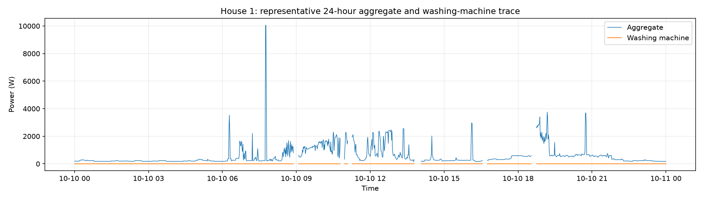
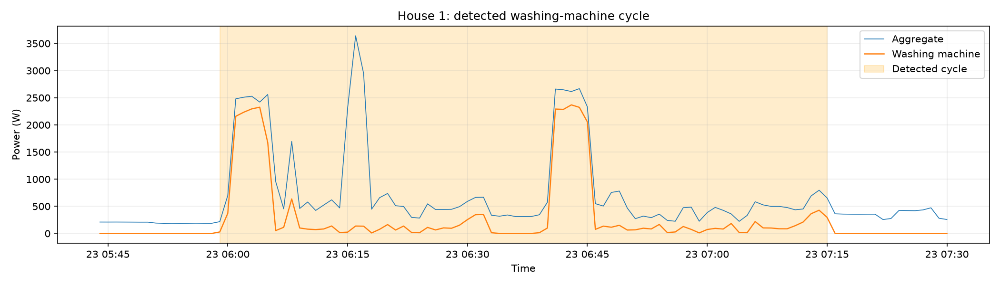
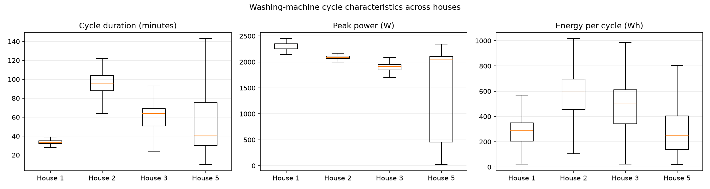
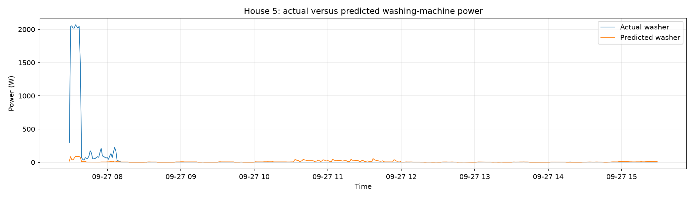

# REFIT analysis results

## Part 2: washing-machine exploratory analysis

### Data and preparation

The analysis uses the official cleaned REFIT files in
`data/cleaned/CLEAN_REFIT_081116/`. Four homes with an identified
washing-machine channel were selected:

| House | Washing-machine channel |
|---:|:---|
| 1 | Appliance5 |
| 2 | Appliance2 |
| 3 | Appliance6 |
| 5 | Appliance3 |

The selected data covers approximately September 2013 to July 2015. The
original REFIT readings are recorded at approximately eight-second intervals.
All readings were converted to one-minute mean power values.

Only the timestamp, aggregate power, washing-machine channel, and `Issues`
columns were loaded. The rows were sorted by time and duplicate timestamps
were reduced to the first reading. Rows with `Issues == 1` were treated as
unreliable, so their aggregate and washing-machine values were set to missing
before resampling.

Internal gaps of up to three minutes were interpolated. Longer gaps were left
missing and were not used for cycle detection or model features.

### Data availability

| House | Start | End | Days | Missing minutes | Missing (%) | Valid minutes | Off time of valid data (%) | Cycles |
|---:|---|---|---:|---:|---:|---:|---:|---:|
| 1 | 2013-10-09 13:06 | 2015-07-10 11:56 | 639.0 | 118,760 | 12.91 | 801,331 | 98.21 | 403 |
| 2 | 2013-09-17 22:08 | 2015-05-28 08:05 | 617.4 | 219,151 | 24.65 | 669,927 | 95.39 | 341 |
| 3 | 2013-09-25 19:21 | 2015-06-02 10:55 | 614.6 | 132,557 | 14.98 | 752,538 | 94.57 | 680 |
| 5 | 2013-09-26 09:56 | 2015-07-06 17:48 | 648.3 | 118,449 | 12.69 | 815,144 | 93.18 | 868 |

House 2 has the highest proportion of missing minutes. The high off-time
values are expected because a washing machine is inactive for most of the
day. They also show why overall accuracy alone would be a poor measure of
washing-machine detection.

### Cycle definition

A minute was labelled active when washing-machine power was above 20 watts.
Inactive pauses of up to ten minutes were joined to the surrounding active
period. This allows one programme to contain short pauses during filling,
heating, or spinning.

Candidate cycles shorter than ten minutes or with energy below 20 watt-hours
were discarded. For one-minute data, energy was calculated as:

`energy in watt-hours = sum of minute power values / 60`

These thresholds are simple analysis choices and can be changed in the
notebook configuration.

### Cycle characteristics

The analysis detected 2,292 cycles across the four homes.

| House | Cycles | Median duration (minutes) | Median energy (Wh) | Median peak power (W) | Mean energy (Wh) |
|---:|---:|---:|---:|---:|---:|
| 1 | 403 | 33 | 287.6 | 2,305.6 | 314.1 |
| 2 | 341 | 96 | 602.4 | 2,088.4 | 583.0 |
| 3 | 680 | 64 | 500.1 | 1,911.0 | 461.8 |
| 5 | 868 | 41 | 247.4 | 2,043.0 | 328.9 |

House 5 has the largest number of detected cycles. House 2 has the longest
typical cycle and the highest median energy per cycle. The differences may be
related to appliance models, wash programmes, household behaviour, and
unequal data coverage.

### Usage patterns

Across all four homes, 10:00 was the most common cycle-start hour:

| Start hour | Cycle count |
|---:|---:|
| 10:00 | 236 |
| 08:00 | 229 |
| 09:00 | 207 |
| 11:00 | 190 |
| 12:00 | 181 |

Saturday had the most detected cycle starts:

| Day | Cycle count |
|---|---:|
| Saturday | 446 |
| Friday | 362 |
| Sunday | 337 |
| Monday | 298 |
| Tuesday | 294 |
| Thursday | 281 |
| Wednesday | 274 |

The selected homes therefore show more activity during late morning and at
weekends. These are associations in a small sample, not causal or
population-level conclusions.

### Required figures

The representative 24-hour plot is saved as
`outputs/representative_24h_trace.png`.

The washing-machine signal appears as intermittent activity within the larger
and more variable aggregate household signal. This illustrates why other
appliances make disaggregation difficult.

The detected-cycle plot is saved as `outputs/detected_cycle_zoom.png`.

The zoomed House 1 example shows one detected programme and the surrounding
aggregate signal. The pause-merging rule prevents short interruptions from
being counted as separate cycles.

The cross-house comparison is saved as
`outputs/cross_house_cycle_comparison.png`.

The box plots show differences in duration, peak power, and energy between
homes. This supports evaluating models on held-out households rather than
assuming that one household represents all others.

### Part 2 output files

The notebook writes these files to `outputs/`:

`washer_availability.csv`

`washer_cycles.csv`

`washer_cycles_by_hour.csv`

`washer_cycles_by_day.csv`

`representative_24h_trace.png`

`detected_cycle_zoom.png`

`cross_house_cycle_comparison.png`

`part2_results_summary.md`

## Part 3: washing-machine disaggregation

### Validation design

Houses 1, 2, and 3 were combined for training. House 5 was held out
completely for testing. This household-level split prevents nearby
one-minute windows from the same home appearing in both training and testing.

The target is one-minute washing-machine power. The model uses current
aggregate power, aggregate lags of 1, 2, 3, 5, and 10 minutes, five-minute
rolling aggregate mean and maximum, hour of day, and day of week.

Rows with missing values, long-gap flags, or insufficient lag history were
excluded. The model is a `HistGradientBoostingRegressor`, and predictions are
clipped at zero watts. The baseline always predicts zero watts. A minute is
considered active when washing-machine power exceeds 20 watts.

### Holdout results

The evaluation contains 790,498 valid one-minute rows from House 5.

| Method | MAE (W) | RMSE (W) | Actual energy (Wh) | Predicted energy (Wh) | Energy error (%) | Active precision | Active recall | Active F1 |
|---|---:|---:|---:|---:|---:|---:|---:|---:|
| Always off | 23.00 | 167.30 | 302,994.4 | 0.0 | 100.00 | 0.000 | 0.000 | 0.000 |
| HistGradientBoosting | 33.74 | 160.22 | 302,994.4 | 261,945.7 | 13.55 | 0.215 | 0.435 | 0.288 |

The model has a higher MAE than the always-off baseline because the washer is
off for most minutes. However, it has lower RMSE, reduces total-energy error
from 100% to 13.55%, and detects 43.5% of active minutes. This is why MAE
should be considered together with energy error and active-state metrics.

### Actual and predicted power

The actual-versus-predicted plot is saved as
`outputs/disaggregation_actual_vs_predicted.png`.

The figure shows an eight-hour House 5 test window beginning at the first
detected active period. The model follows some broad load changes but smooths
or misses several short peaks. This matches the moderate recall and low
precision for active-state detection.

### Failure cases and limitations

The model can confuse other high-power appliances with the washing machine
when their aggregate signatures overlap. It can miss short or low-power
washing phases and may transfer poorly to households with different
appliances or routines. Long missing intervals are excluded rather than
filled, so the results describe valid observed minutes only.

The always-off result also shows the effect of class imbalance. A low MAE
does not necessarily mean that appliance events are being identified usefully.

### Part 3 output files

The notebook writes these files to `outputs/`:

`disaggregation_model_results.csv`

`disaggregation_data_summary.csv`

`disaggregation_actual_vs_predicted.png`

## Part 4: practical implications

The recommended use is an opt-in, non-billing feedback pilot that helps
customers shift flexible washing-machine use away from a local peak-demand
period. The model should provide broad guidance rather than definitive claims
about individual appliance activity.

The pilot should use feedback and control groups, measure peak-period
washing-machine energy and total household energy for eight to twelve weeks,
and validate a sample of detections with plug-level monitors or customer
diaries. Success would require lower target peak-period energy without higher
total consumption or unacceptable customer complaints.

The main limitations are overlapping appliance signatures, missing data, the
small UK-only sample, and differences between REFIT homes and households in
India. With 15-minute or 30-minute readings, short washing-machine phases
would be averaged together. Broad load-shifting analysis would remain
possible, but exact cycle timing and appliance detection would become less
reliable.

The complete utility-facing recommendation is in
`Recommendation.md`.
